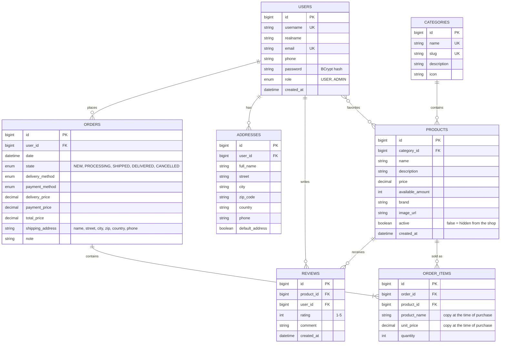

# E-shop

An online electronics store built as a semester project for the NUR course (CTU in Prague).
Customers browse the catalogue, fill a cart, order and follow their orders; administrators run the shop.

- **Backend** – Java 17, Spring Boot 3, Spring Security (JWT), JPA, H2 / PostgreSQL
- **Frontend** – Angular 17 (standalone components, signals), Nx workspace, Bootstrap 5

## Contents

1. [Quick start](#quick-start)
2. [What the shop can do](#what-the-shop-can-do)
3. [User roles](#user-roles)
4. [User stories](#user-stories)
5. [Data model](#data-model)
6. [REST API](#rest-api)
7. [Project structure](#project-structure)
8. [UI design decisions](#ui-design-decisions)
9. [Tests](#tests)
10. [Plan and backlog](#plan-and-backlog)

## Quick start

Requirements: **JDK 17–21** and **Node.js 18+**. No database has to be installed.

```bash
# 1. Backend – http://localhost:8090 (Swagger UI: http://localhost:8090/swagger-ui.html)
./gradlew bootRun            # Windows: gradlew.bat bootRun

# 2. Frontend – http://localhost:4200
cd selling-frontend
npm install
npm start
```

> Gradle 8.5 does not run on JDK 22 or newer. If `java -version` shows a newer one,
> point `JAVA_HOME` to JDK 17 before running Gradle.

On the first start the database is filled with demo data (25 products, 6 categories, orders, reviews).

| Demo account  | Username | Password   |
|---------------|----------|------------|
| Customer      | `jana`   | `jana123`  |
| Customer      | `petr`   | `petr123`  |
| Administrator | `admin`  | `admin123` |

**Database.** By default the data lives in an embedded H2 file in `./data`. Delete that folder to start
again with fresh demo data (handy before a usability test). To use PostgreSQL instead:

```bash
docker compose up -d
./gradlew bootRun --args="--spring.profiles.active=postgres"
```

## What the shop can do

**Storefront**
- Home page with categories, new arrivals and cheap picks
- Catalogue with full-text search, category / price / availability filters, sorting and paging;
  every result has its own address, so it can be bookmarked or shared and the Back button works
- Product page with stock status, reviews and related products
- Cart that works without signing in and survives closing the browser
- Three-step checkout (address → delivery and payment → summary) with saved addresses
- Customer account: order history, order tracking, cancelling and re-ordering, favourites,
  address book, profile and password change

**Administration** (`/admin`)
- Dashboard: revenue, orders by state, best sellers, products running low
- Orders: filtering by state, customer and date, detail, state changes
- Products and categories: create, edit, hide from the shop
- Users: roles and removal

## User roles

| Role              | Who it is                          | What they can do                                           |
|-------------------|------------------------------------|------------------------------------------------------------|
| **Visitor**       | Anybody without an account         | Browse, search, fill the cart, register                    |
| **Customer**      | Signed-in user (`USER`)            | Everything above + order, reviews, favourites, account     |
| **Administrator** | Shop staff (`ADMIN`)               | Everything above + administration of the whole shop        |

## User stories

Status: ✅ implemented · 🔲 in the backlog. Each story has acceptance criteria that can be turned
directly into a usability test task.

### Browsing and searching

| ID   | Story | Acceptance criteria | |
|------|-------|---------------------|-|
| US-01 | As a **visitor** I want to see what the shop offers right on the home page so that I know whether it is worth staying. | Categories, newest products and cheapest products are visible without any click. | ✅ |
| US-02 | As a **visitor** I want to search products by name so that I find a specific thing quickly. | Search box is on every page; it searches name, brand and description; an empty result explains what to do next. | ✅ |
| US-03 | As a **visitor** I want to narrow products by category, price and availability so that I only see what I can buy. | Filters combine; active filters are shown as removable chips; "Clear all" resets them. | ✅ |
| US-04 | As a **visitor** I want to sort products by price or novelty so that I can compare them. | Sorting keeps the filters; the choice is kept in the address. | ✅ |
| US-05 | As a **visitor** I want to see details, stock and reviews of a product so that I can decide. | Stock is shown as *In stock / Last N pcs / Sold out*; a sold-out product cannot be added to the cart. | ✅ |
| US-06 | As a **visitor** I want to see real photos of products from several angles. | Gallery with several images per product. | 🔲 |
| US-07 | As a **visitor** I want to compare two or more products side by side. | Comparison table of parameters. | 🔲 |

### Cart and checkout

| ID   | Story | Acceptance criteria | |
|------|-------|---------------------|-|
| US-10 | As a **visitor** I want to put products into a cart without registering so that I am not forced to create an account too early. | Cart works for anonymous users and is kept after the browser is closed. | ✅ |
| US-11 | As a **visitor** I want to change quantities and remove items in the cart so that I can fix my choice. | Quantity cannot exceed the stock; a removed item can be returned with *Undo*. | ✅ |
| US-12 | As a **customer** I want to be told when something in my cart sold out so that I am not surprised at the end. | The cart is checked against the stock when opened and at checkout; changes are listed. | ✅ |
| US-13 | As a **customer** I want to pick one of my saved addresses so that I do not type it every time. | The default address is preselected; a new one can be entered and saved. | ✅ |
| US-14 | As a **customer** I want to choose delivery and payment and see their prices so that I know the final price before ordering. | Price of each option is visible; the total updates immediately. | ✅ |
| US-15 | As a **customer** I want to review the whole order before I confirm it so that I can catch mistakes. | Summary shows address, delivery, payment, items and total; each part has a *Change* link. | ✅ |
| US-16 | As a **customer** I want a clear confirmation after ordering so that I know it worked. | Thank-you message with the order number and a link to follow the order. | ✅ |
| US-17 | As a **customer** I want to pay online by card. | Integration of a payment gateway. | 🔲 |
| US-18 | As a **customer** I want to use a discount code. | Code field in the cart, discount shown in the summary. | 🔲 |

### Account

| ID   | Story | Acceptance criteria | |
|------|-------|---------------------|-|
| US-20 | As a **visitor** I want to create an account so that I can order. | Validation messages appear next to the fields; a taken username or e-mail is explained. | ✅ |
| US-21 | As a **customer** I want to sign in and be returned to where I was so that I do not lose my place. | After signing in from the checkout I continue in the checkout with my cart. | ✅ |
| US-22 | As a **customer** I want to see my orders and their state so that I know when the goods arrive. | List of orders; detail with a progress timeline. | ✅ |
| US-23 | As a **customer** I want to cancel an order that has not been shipped yet. | Cancelling asks for confirmation; goods return to stock; a shipped order cannot be cancelled and says why. | ✅ |
| US-24 | As a **customer** I want to order the same things again. | *Order again* fills the cart with the items that are still available. | ✅ |
| US-25 | As a **customer** I want to save products as favourites so that I can come back to them. | Heart on every product; list in the account; a visitor is asked to sign in. | ✅ |
| US-26 | As a **customer** I want to rate and review a product so that I help others. | 1–5 stars and optional text; one review per product, it can be edited or deleted. | ✅ |
| US-27 | As a **customer** I want to manage my addresses, personal details and password. | Address book with a default address; profile form; password change needs the current password. | ✅ |
| US-28 | As a **customer** I want to reset a forgotten password by e-mail. | Reset link sent by e-mail. | 🔲 |
| US-29 | As a **customer** I want to get e-mails about my order. | E-mail on order creation and on each state change. | 🔲 |

### Administration

| ID   | Story | Acceptance criteria | |
|------|-------|---------------------|-|
| US-30 | As an **administrator** I want an overview of the shop so that I see what needs attention. | Dashboard shows new orders, revenue, best sellers and products running low. | ✅ |
| US-31 | As an **administrator** I want to find orders by state, customer and date. | Filters combine; an empty result offers clearing the filter. | ✅ |
| US-32 | As an **administrator** I want to move an order through its states. | Closing steps (*Delivered*, *Cancelled*) ask for confirmation; closed orders cannot be changed. | ✅ |
| US-33 | As an **administrator** I want to add and edit products. | Form with validation; price and stock cannot be negative. | ✅ |
| US-34 | As an **administrator** I want to take a product off sale without breaking old orders. | Product is hidden from the shop, stays in order history and can be put back. | ✅ |
| US-35 | As an **administrator** I want to manage categories. | A category with products cannot be deleted and the message explains why. | ✅ |
| US-36 | As an **administrator** I want to manage users and their roles. | Nobody can remove or demote their own account. | ✅ |
| US-37 | As an **administrator** I want to upload product photos from my computer. | File upload instead of an image address. | 🔲 |
| US-38 | As an **administrator** I want to export orders to CSV. | Export of the filtered list. | 🔲 |

## Data model



Rules worth knowing:

- **An order is a snapshot.** Product name, unit price and the delivery address are copied into the order,
  so later edits of a product or an address never rewrite history.
- **Products are never deleted**, only hidden (`active = false`), because orders reference them.
- **Stock** is reserved when an order is created (with a row lock, so two customers cannot buy the same last
  piece) and returned when the order is cancelled. Prices are always computed on the server.
- **Order states:** `NEW → PROCESSING → SHIPPED → DELIVERED`; `CANCELLED` is possible until shipping
  (customer) or until the order is closed (administrator). `DELIVERED` and `CANCELLED` are final.
- **One review** per user and product (unique constraint); sending another one rewrites it.

## REST API

Full interactive documentation: <http://localhost:8090/swagger-ui.html> (use *Authorize* with the token
returned by the login).

| Area | Endpoints | Access |
|------|-----------|--------|
| Authentication | `POST /api/auth/register`, `POST /api/auth/login` | public |
| Profile | `GET/PUT /api/auth/me`, `PUT /api/auth/me/password` | signed in |
| Catalogue | `GET /api/products` (`q`, `categoryId`, `minPrice`, `maxPrice`, `inStock`, `sort`, `page`, `size`), `GET /api/products/{id}`, `GET /api/products/batch`, `GET /api/categories` | public |
| Reviews | `GET /api/products/{id}/reviews` · `POST /api/products/{id}/reviews`, `DELETE /api/reviews/{id}` | public · signed in |
| Checkout | `GET /api/checkout/options` · `POST /api/orders` | public · signed in |
| My orders | `GET /api/orders`, `GET /api/orders/{id}`, `POST /api/orders/{id}/cancel` | signed in (own orders) |
| Favourites | `GET /api/favorites`, `PUT/DELETE /api/favorites/{productId}` | signed in |
| Addresses | `GET/POST /api/addresses`, `PUT/DELETE /api/addresses/{id}` | signed in (own addresses) |
| Catalogue management | `POST/PUT/DELETE /api/products/**`, `POST/PUT/DELETE /api/categories/**` | administrator |
| Administration | `GET /api/admin/stats`, `GET /api/admin/products`, `GET /api/admin/orders` (`state`, `user`, `dateTo`), `PATCH /api/admin/orders/{id}/state`, `GET /api/admin/users`, `PATCH /api/admin/users/{id}/role`, `DELETE /api/admin/users/{id}` | administrator |

Errors always have the same shape, so the frontend can show them next to the right field:

```json
{ "status": 400, "message": "Price must be positive", "fieldErrors": { "price": "Price must be positive" } }
```

## Project structure

```
src/main/java/eshop
├── configuration   security (JWT, CORS, roles), OpenAPI, demo data
├── controller      REST endpoints
├── contracts       request / response objects (records) with validation
├── domain          JPA entities and enums
├── exception       ApiException and one global error handler
├── repository      Spring Data repositories
└── service         business rules (stock, order states, ownership checks)

selling-frontend
├── apps/selling-frontend   application shell, routes, global styles (design tokens)
└── libs
    ├── domain    models, API services, auth, cart, guards, interceptor
    ├── shared    reusable UI: product card, dialog, toasts, rating, form field, pagination...
    ├── shop      storefront pages: home, catalogue, product, cart, checkout, account
    └── selling   administration pages: dashboard, orders, products, categories, users
```

## UI design decisions

Short notes on *why* the interface behaves the way it does – useful for the NUR report.

- **Visibility of system status** – every action answers with a toast; lists have loading skeletons,
  empty states with a next step and a retry on failure; the cart badge shows the count and the price.
- **Error prevention** – a sold-out product cannot be added; quantity is limited by the stock; forms validate
  before sending; destructive actions ask for confirmation in the user's words ("Cancel order" / "Keep order").
- **Undo instead of confirm** for cheap mistakes – removing an item from the cart can simply be taken back.
- **Recognition over recall** – active filters are visible as chips; the checkout summary repeats every
  choice with a *Change* link; saved addresses are offered instead of typed.
- **No forced registration** – the cart works for anonymous visitors; sign-in is asked for only at checkout
  and returns the user to where they were.
- **Stable layout** – room for validation messages is reserved, so a message appearing when a field loses
  focus never moves the button the user is about to click.
- **Accessibility** – semantic landmarks and headings, labels on all inputs, visible keyboard focus,
  skip link, dialogs closable with Esc, `aria-live` toasts, colour contrast of at least 4.5:1,
  state is never communicated by colour alone, `prefers-reduced-motion` is respected.
- **Responsive** – from 360 px wide phones (filters become a full-screen panel, tables scroll) to desktop.

## Tests

```bash
./gradlew test                              # backend: repositories, order rules, security
cd selling-frontend
npx nx run-many -t test                     # frontend unit tests (cart, price formatting, app shell)
npx nx run-many -t lint
npx nx e2e selling-frontend-e2e             # Cypress, needs the backend running
```

## Plan and backlog

**Done in this iteration**

1. Data model extended from 3 to 7 tables (categories, order items, addresses, reviews, favourites).
2. Backend rebuilt: working JWT security with roles, validation, uniform errors, stock handling, search.
3. Storefront for customers (it did not exist before) and a reworked administration.
4. Demo data, tests, documentation.

**Next iterations** (ordered by value for the customer; IDs refer to the user stories above)

| Priority | Item | Stories |
|----------|------|---------|
| 1 | E-mail notifications and password reset | US-28, US-29 |
| 2 | Product photo upload and gallery | US-06, US-37 |
| 3 | Online payment | US-17 |
| 4 | Discount codes | US-18 |
| 5 | Product comparison | US-07 |
| 6 | CSV export of orders | US-38 |
| 7 | Czech localisation of the interface | – |

**Suggested usability test tasks** (cover the main flows):

1. Find wireless headphones under 3 000 Kč that are in stock and add them to the cart.
2. Order the cart to a parcel locker and pay on delivery. What is the final price?
3. Find out where your last order is and cancel it.
4. Save a product for later and find it again from a different page.
5. (Administrator) A customer called that their parcel arrived – mark the order as delivered.
6. (Administrator) Product *PowerBank 20000* has been restocked with 30 pieces – update it.
